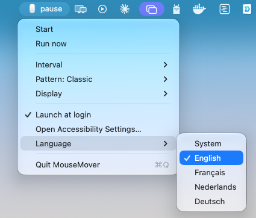

# MouseMover

[](https://github.com/AlexandreBeauduin/MouseMover/actions/workflows/ci.yml)

[English](README.md) · [Français](README.fr.md) · [Nederlands](README.nl.md) · **Deutsch**

Eine kleine macOS-Menüleisten-App, die die Maus in regelmäßigen Abständen bewegt, nach
Mustern, die du selbst zeichnen oder aufzeichnen kannst, damit die Sitzung wach und dein
Status „aktiv“ bleibt.

> **Vibe coded.** Dieses Projekt entstand im Gespräch mit einem KI-Programmierassistenten
> (Claude Code): Der Mensch beschrieb, was er wollte, testete auf echter Hardware und
> steuerte; die KI schrieb Code und Dokumentation. Es funktioniert auf dem Rechner des
> Autors; lies den Code, bevor du ihm auf deinem vertraust.

## Funktionen



- **Starten / Stoppen**, **Jetzt ausführen**, Countdown bis zum nächsten Zyklus in der Menüleiste.
- Intervall: 1, 3, 5, 10, 15 Minuten oder eigener Wert.
- **Muster**: vier integrierte (*Klassisch*, *Dezent*, *Kreis*, *Zickzack*) und deine eigenen:
  - Punkt für Punkt im Editor gezeichnet (Klick, Pause, feste oder „menschliche“ Bahn, Reihenfolge);
  - oder **eine Geste aufzeichnen**: MouseMover zeichnet deine echten Mausbewegungen und Klicks auf;
  - auf dem Bildschirm oder um den Mauszeiger, der Reihe nach oder gemischt;
  - immer dasselbe, ein zufälliges oder der Reihe nach.
- Bildschirmwahl (folgt standardmäßig dem Hauptbildschirm), mehrere Bildschirme.
- **Fail-safe**: Bewege die Maus in die obere linke Ecke des Hauptbildschirms, und der Zyklus stoppt.
- Start bei der Anmeldung.
- Aktionen für **Kurzbefehle**: starten, stoppen, jetzt ausführen, Intervall festlegen,
  Bildschirm oder Muster wählen.
- Oberfläche auf **Englisch, Französisch, Niederländisch und Deutsch**: folgt der
  macOS-Sprache, oder wähle eine im Menü (*Sprache*).

## Installation

**Download:** Lade `MouseMover-x.y.z.zip` von der Seite
[Releases](https://github.com/AlexandreBeauduin/MouseMover/releases), entpacke es und
verschiebe `MouseMover.app` nach `/Applications`. Universal Binary (Apple Silicon + Intel), macOS 14+.

**Aus dem Quellcode** (Xcode 16 oder neuer, [XcodeGen](https://github.com/yonaskolb/XcodeGen)):

```bash
brew install xcodegen
scripts/build-app.sh --install   # baut MouseMover.app und kopiert sie nach /Applications
```

Eine heruntergeladene Kopie ist nicht mit einer Developer ID signiert: macOS blockiert sie
beim ersten Start → Systemeinstellungen › Datenschutz & Sicherheit › **Dennoch öffnen**.

### Berechtigung für Bedienungshilfen

Die Maus zu bewegen erfordert **Systemeinstellungen › Datenschutz & Sicherheit ›
Bedienungshilfen**. MouseMover fragt beim ersten Start danach; das Menü zeigt
*⚠︎ Bedienungshilfen erlauben…*, solange sie fehlt.

macOS bindet diese Berechtigung an die Signatur der App. Releases sind ad hoc signiert:
Entferne MouseMover nach **jedem Update** aus der Liste (−) und erlaube die App erneut.

## Funktionsweise (kurz)

- In jedem Intervall spielt MouseMover ein Muster auf dem gewählten Bildschirm mit `CGEvent`
  ab (Bewegungen mit Beschleunigungskurven, zufällige Pausen, optionale Klicks).
- Ein Muster ist eine Liste von Punkten in Bruchteilen des Bildschirms (oder des Bereichs um
  den Mauszeiger); Punkte ohne feste Dauer erhalten eine zufällige, menschliche Bahn.
- Einstellungen und Muster: `~/Library/Application Support/MouseMover/config.json`.

Details: [Funktionsweise](docs/de/FUNKTIONSWEISE.md) · [Architektur](docs/de/ARCHITEKTUR.md)

## Entwicklung

```bash
scripts/test.sh            # Unit-Tests — keine echte Maus bewegt, kein echtes Anmeldeobjekt
scripts/build-app.sh       # universeller Release-Build in build/MouseMover.app + Prüfungen
scripts/release.sh         # Build + build/MouseMover-<Version>.zip (+ .sha256)
```

Das Xcode-Projekt wird von XcodeGen aus `project.yml` erzeugt (nicht eingecheckt). Builds sind
ad hoc signiert; um die Bedienungshilfen-Berechtigung über eigene Builds hinweg zu behalten,
signiere mit deinem Zertifikat in `Config/Local.xcconfig` (siehe `Config/Signing.xcconfig`).

Release veröffentlichen: Erhöhe `MARKETING_VERSION` in `project.yml`, füge einen Abschnitt in
[CHANGELOG.md](CHANGELOG.md) hinzu und pushe ein passendes Tag
(`git tag v2.1.0 && git push origin v2.1.0`): GitHub Actions testet, baut und veröffentlicht das Release.

## Einschränkungen

- Klicks sind echte Klicks: Ein Muster, das klickt, kann auf alles wirken, was unter dem
  Mauszeiger liegt. Das integrierte Muster *Klassisch* klickt einmal in der Bildschirmmitte.
- Manche Apps oder Richtlinien erkennen Inaktivität eventuell anders; MouseMover simuliert
  nur die Maus.

## Lizenz und Haftungsausschluss

MIT — siehe [LICENSE](LICENSE). Bereitgestellt **wie besehen, ohne jede Gewährleistung**.
Dieses Projekt ist nicht mit Apple verbunden oder von Apple unterstützt. Prüfe die Regeln
deines Arbeitgebers, bevor du es bei der Arbeit verwendest.
