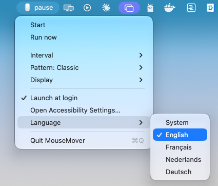

# MouseMover

[](https://github.com/AlexandreBeauduin/MouseMover/actions/workflows/ci.yml)

[English](README.md) · [Français](README.fr.md) · **Nederlands** · [Deutsch](README.de.md)

Een kleine macOS-menubalkapp die de muis op vaste tijden beweegt, volgens patronen die je
zelf kunt tekenen of opnemen, zodat je sessie wakker blijft en je status "actief".

> **Vibe coded.** Dit project is gebouwd in gesprek met een AI-programmeerassistent
> (Claude Code): de mens beschreef wat hij wilde, testte op echte hardware en stuurde bij;
> de AI schreef de code en de documentatie. Het werkt op de machine van de auteur; lees de
> code voordat je het op de jouwe vertrouwt.

## Functies



- **Starten / Stoppen**, **Nu uitvoeren**, aftelling tot de volgende cyclus in de menubalk.
- Interval: 1, 3, 5, 10, 15 minuten of aangepast.
- **Patronen**: vier ingebouwde (*Klassiek*, *Discreet*, *Cirkel*, *Zigzag*) en je eigen:
  - punt voor punt getekend in de editor (klik, pauze, vast of "menselijk" traject, volgorde);
  - of **een gebaar opnemen**: MouseMover neemt je echte muisbewegingen en klikken op;
  - op het scherm of rond de cursor, op volgorde of geschud;
  - altijd hetzelfde, een willekeurig, of om de beurt.
- Schermkeuze (volgt standaard het hoofdscherm), werkt met meerdere schermen.
- **Fail-safe**: beweeg de muis naar de linkerbovenhoek van het hoofdscherm en de cyclus stopt.
- Openen bij inloggen.
- Acties voor **Opdrachten** (Shortcuts): starten, stoppen, nu uitvoeren, interval instellen,
  scherm of patroon kiezen.
- Interface in het **Engels, Frans, Nederlands en Duits**: volgt de macOS-taal, of kies er
  een in het menu (*Taal*).

## Installatie

**Downloaden:** haal `MouseMover-x.y.z.zip` op de pagina
[Releases](https://github.com/AlexandreBeauduin/MouseMover/releases), pak uit en verplaats
`MouseMover.app` naar `/Applications`. Universele binary (Apple Silicon + Intel), macOS 14+.

**Vanuit de broncode** (Xcode 16 of nieuwer, [XcodeGen](https://github.com/yonaskolb/XcodeGen)):

```bash
brew install xcodegen
scripts/build-app.sh --install   # bouwt en kopieert MouseMover.app naar /Applications
```

Een gedownloade kopie is niet ondertekend met een Developer ID: macOS blokkeert hem bij de
eerste start → Systeeminstellingen › Privacy en beveiliging › **Toch openen**.

### Toegankelijkheidstoestemming

De muis bewegen vereist **Systeeminstellingen › Privacy en beveiliging › Toegankelijkheid**.
MouseMover vraagt erom bij de eerste start; het menu toont *⚠︎ Toegankelijkheid toestaan…*
zolang ze ontbreekt.

macOS koppelt deze toestemming aan de handtekening van de app. Releases zijn ad hoc
ondertekend: verwijder MouseMover na **elke update** uit de lijst (−) en sta hem opnieuw toe.

## Hoe het werkt (kort)

- Bij elk interval speelt MouseMover één patroon af op het gekozen scherm met `CGEvent`
  (bewegingen met versnellingscurves, willekeurige pauzes, eventuele klikken).
- Een patroon is een lijst punten in fracties van het scherm (of van het gebied rond de
  cursor); punten zonder vaste duur krijgen een willekeurig, menselijk traject.
- Instellingen en patronen: `~/Library/Application Support/MouseMover/config.json`.

Details: [Hoe het werkt](docs/nl/HOE-HET-WERKT.md) · [Architectuur](docs/nl/ARCHITECTUUR.md)

## Ontwikkeling

```bash
scripts/test.sh            # unittests — geen echte muis bewogen, geen echt inlogonderdeel
scripts/build-app.sh       # universele Release-build in build/MouseMover.app + controles
scripts/release.sh         # build + build/MouseMover-<versie>.zip (+ .sha256)
```

Het Xcode-project wordt door XcodeGen gegenereerd uit `project.yml` (niet in git). Builds zijn
ad hoc ondertekend; om de toegankelijkheidstoestemming tussen je eigen builds te behouden,
onderteken je met je certificaat in `Config/Local.xcconfig` (zie `Config/Signing.xcconfig`).

Een release uitbrengen: verhoog `MARKETING_VERSION` in `project.yml`, voeg een sectie toe aan
[CHANGELOG.md](CHANGELOG.md) en push een overeenkomende tag
(`git tag v2.1.0 && git push origin v2.1.0`): GitHub Actions test, bouwt en publiceert de release.

## Beperkingen

- Klikken zijn echte klikken: een patroon dat klikt, kan inwerken op wat onder de cursor
  ligt. Het ingebouwde patroon *Klassiek* klikt één keer in het midden van het scherm.
- Sommige apps of beleidsregels detecteren inactiviteit misschien anders; MouseMover
  simuleert alleen de muis.

## Licentie en disclaimer

MIT — zie [LICENSE](LICENSE). Geleverd **zoals het is, zonder enige garantie**. Dit project
is niet verbonden aan of goedgekeurd door Apple. Controleer de regels van je werkgever
voordat je het op het werk gebruikt.
